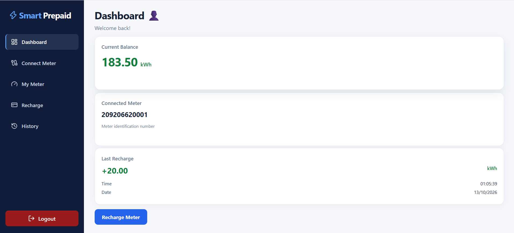
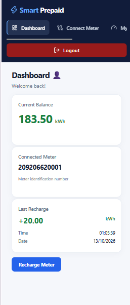
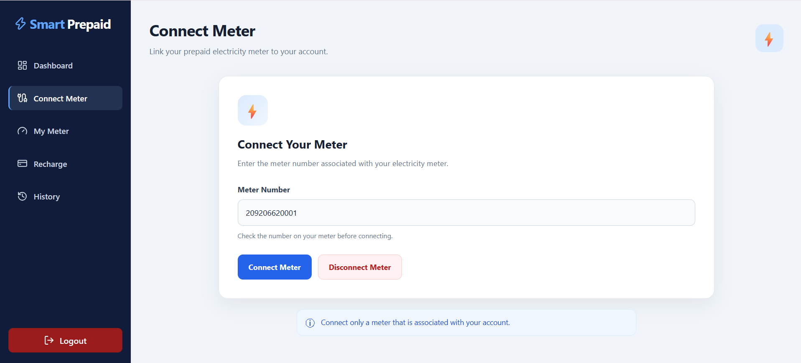
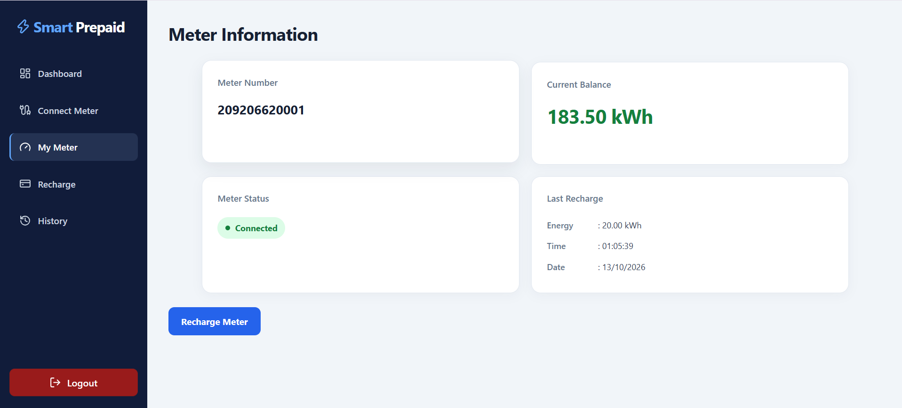
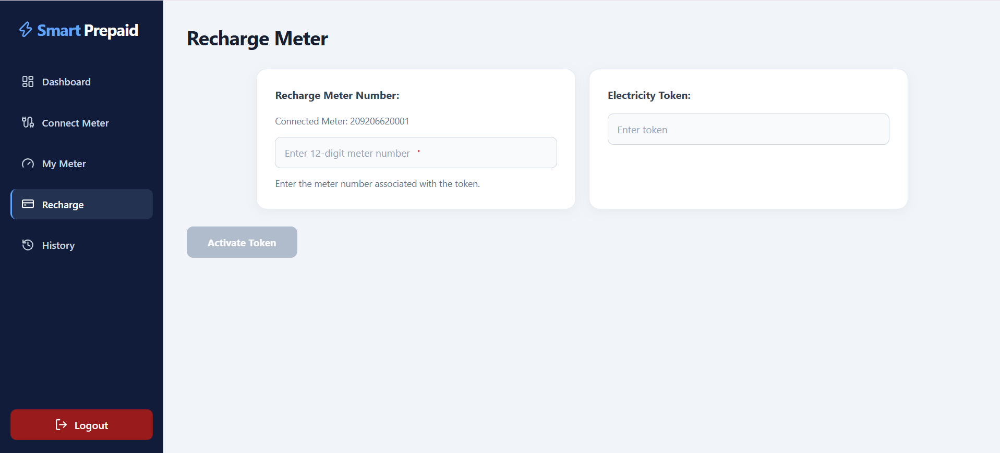
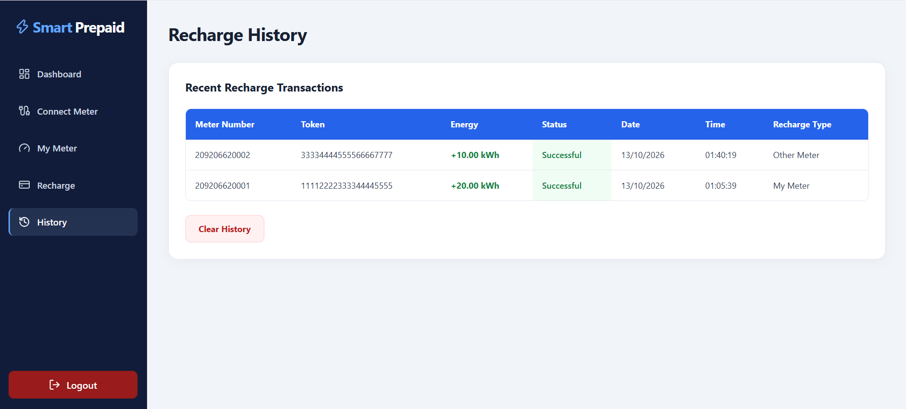

# SmartPrepaid ⚡

A full-stack prepaid electricity meter dashboard prototype built to demonstrate account authentication, meter management, recharge-token validation, and electricity balance tracking. SmartPrepaid features a modern, responsive interface designed for desktop, tablet, and mobile devices.

> **Project status:** Portfolio/demo project. It is not connected to ENEO or a live electricity-meter/token provider. Use only test data.

## ✨ Features

### Dashboard and user interface
- Modern dashboard displaying current meter balance, connected meter information, and the latest recharge.
- Responsive layouts for desktop, tablet, and mobile screens.
- Sidebar navigation with icons for quick access to application pages.
- Active navigation highlighting to indicate the current page.
- Sidebar logout control.
- Interactive dashboard cards with subtle hover animations on supported desktop devices.

### Account and meter management
- User registration and login.
- Session-protected meter and recharge endpoints.
- Connect and disconnect meters for a signed-in user.
- View connected meter information and current balance.

### Recharge and history
- Validate token status and confirm that a token belongs to the submitted meter.
- Update meter balance and record a recharge within a PostgreSQL transaction.
- View recharge history and recharge records.

## 🖼️ Screenshots









## 🛠️ Tech Stack

**Frontend**
- React
- Vite
- React Router
- Lucide React icons

**Backend**
- Node.js
- Express.js
- `express-session`
- `bcrypt`

**Database**
- PostgreSQL
- `pg`

## 📋 Requirements

- Node.js 20.6 or newer.
- PostgreSQL.
- npm.

The backend uses Node.js's `--env-file` option.

## 🚀 Local Setup

### 1. Clone the repository

```bash
git clone https://github.com/Emperorsolarie/smart-prepaid.git
cd smart-prepaid
```

### 2. Create the database

Create a PostgreSQL database named `smartprepaid`.

The application expects tables named `users`, `meter`, `user_meters`, `tokens`, and `recharges`, with columns referenced by the SQL queries in `backend/index.js`.

Create the database schema and any required sample data locally before using the API. Use test data only; never add real customer information or real electricity tokens to a public demo database.

### 3. Configure the backend

Open a terminal in the project root and run:

```bash
cd backend
npm install
```

Copy `backend/.env.example` to `backend/.env` and configure your local PostgreSQL credentials and a long, random session secret.

Keep `backend/.env` private. It should remain excluded from Git.

Start the backend:

```bash
npm run dev
```

The API defaults to:

`http://localhost:5000`

### 4. Configure the frontend

Open a second terminal in the project root:

```bash
npm install
npm run dev
```

Vite normally serves the frontend at:

`http://localhost:5173`

The frontend currently calls the local API at `http://localhost:5000`. Run both applications locally for the demo, and ensure the backend's CORS configuration allows the frontend's actual development origin.

### 5. Build and lint

From the project root, run:

```bash
npm run build
npm run lint
```

## 🔐 Security Notes

- Never commit `.env` files, database passwords, session secrets, or real token data.
- Use HTTPS, secure cookie settings, a production session store, and production-specific CORS settings before deploying.
- Protect authentication and session-related endpoints appropriately.
- This prototype is not a production prepaid-meter payment or token-activation service.

## 📁 Project Structure

```text
smart-prepaid/
├── backend/             # Express API and PostgreSQL connection
├── src/
│   ├── components/      # Dashboard, authentication, meter, recharge, history
│   ├── App.jsx          # Application routes and authentication state
│   └── main.jsx         # React entry point
├── public/
├── package.json
└── README.md
```

## 👨‍💻 Author

Developed as a full-stack software engineering portfolio project using React, Express.js, and PostgreSQL.

GitHub: [Emperorsolarie](https://github.com/Emperorsolarie)

---

**SmartPrepaid — A portfolio prototype for prepaid electricity meter management.**

